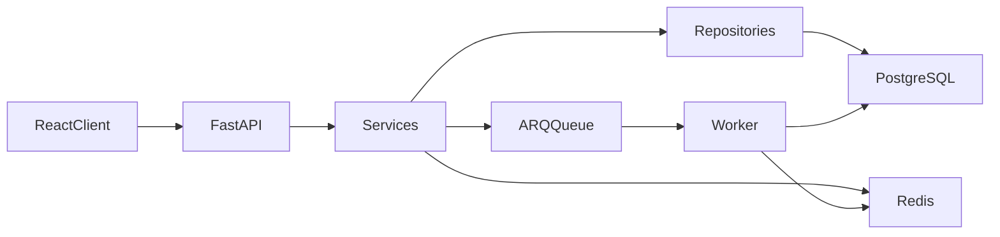
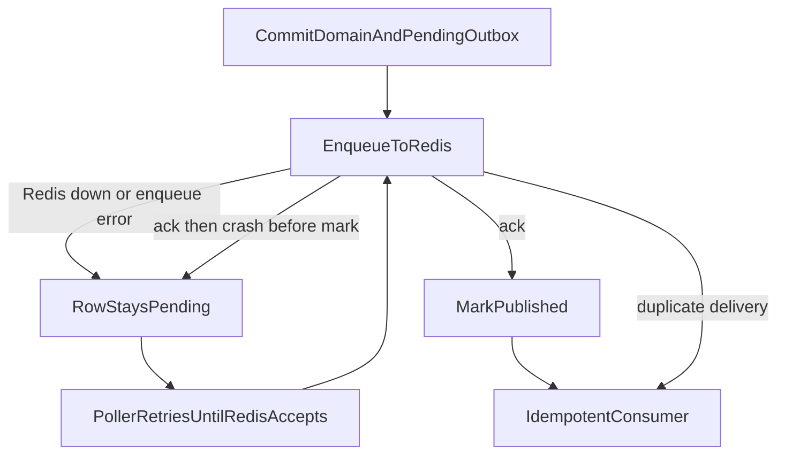

# Architecture

DevSphere is a modular monolith. One API process and one worker process share a codebase with a strict layering. A service is extracted only when a later milestone shows an independent scaling or failure domain. Kubernetes is not part of this design.

## Runtime

The React client arrives in M4. Nginx sits in front of the API and the web app in M10. Until then, the client talks to the API directly.

## Request path

1. Router under `/api/v1`. Platform health stays at `/health`, outside the versioned API.
2. Dependencies: current user, organization, permission, and CSRF on cookie-authenticated mutations.
3. Service. Business rules live here.
4. Repository. This is the only layer that queries the database.
5. PostgreSQL, and Redis when the service needs a cache, a rate-limit counter, or a queue.

Routers stay thin. Every tenant-owned query filters on `organization_id`. The database also rejects a cross-organization parent reference through composite foreign keys. From M8, row-level security repeats the tenant filter inside the database. The foreign key blocks a bad write. RLS blocks a forgotten filter on read. Neither replaces the other.

Organization comes from the path (`/orgs/{org_id}/...`) and must match an authenticated membership. A client-supplied filter is not the tenant context.

## Layout

Created when M0 starts. Nothing under `apps/` exists yet.

- `apps/api/` — FastAPI: `api`, `core`, `db`, `models`, `schemas`, `services`, `repositories`, `dependencies`, `workers`
- `apps/web/` — React, TypeScript, Tailwind, from M4
- `benchmarks/` — Locust scenarios, from M4
- `infra/` — Compose for the API and local Redis. Development Postgres is the shared Supabase database in [ADR 019](DECISIONS.md). Nginx arrives in M10.
- `docs/` — these notes
- `practice/` — weekly Python problem notes, separate from the product

## Tenancy

One database, one schema, `organization_id` on every tenant row. Repositories filter by tenant. Parents expose `UNIQUE (organization_id, id)`. Children reference that pair. See [DATABASE_DESIGN.md](DATABASE_DESIGN.md) and [ADR 002](DECISIONS.md) and [ADR 006](DECISIONS.md).

Schema-per-tenant and database-per-tenant stay out at the planned capacity: about 100 organizations, 20 members each, tens of projects, hundreds of tasks, and low hundreds of documents.

## Authentication

Short-lived access JWT. Rotating refresh tokens stored hashed and grouped in families. Reuse of a rotated token revokes the family. Logout revokes the current family. Password change and password reset revoke every family for that user.

The browser sends the access token in an HttpOnly cookie. The refresh cookie is HttpOnly and limited to the refresh and logout paths. Tests and non-browser clients may send `Authorization: Bearer`.

Cookie-authenticated mutations require a signed, session-bound double-submit CSRF token. The HMAC payload contains the refresh-token family id, issued-at, and expiry. The header `X-CSRF-Token` must match the cookie, the signature must verify, and the family must be the current session. Bearer requests are exempt. CORS is an explicit origin allowlist. It controls which JavaScript origins may read a response. It is not the CSRF control. Details are in [ADR 004](DECISIONS.md) and [ADR 007](DECISIONS.md).

Account status is `active` or `disabled`. A disabled user cannot obtain or refresh tokens.

## Outbox

Domain writes and a `pending` outbox row commit in one PostgreSQL transaction. After commit, the publisher enqueues to Redis through ARQ and only then marks the row `published`.

Marking the row published before Redis accepts the enqueue can lose the event. The poller skips a published row. If the process dies, or Redis errors, after that mark and before a successful enqueue, nothing retries and the queue does not have the message.

The remaining crash is safe in the other direction: Redis has accepted the message, then the process dies before the mark. The poller enqueues again. The consumer's unique key makes the duplicate one effect.

The poller claims with `FOR UPDATE SKIP LOCKED`, sets `publishing`, `locked_until`, and a lock owner. Concurrent workers take different rows. An expired lock is abandoned and another worker reclaims it. The loop backs off while Redis refuses connections and publishes again when Redis accepts them. Recovery does not require a new deploy or a replay from Redis.

At-least-once delivery is the guarantee. The API returns before fan-out finishes, so the notification appears on a later read. Exactly-once delivery is not claimed. ARQ is the only worker runtime. See [ADR 003](DECISIONS.md) and [ADR 008](DECISIONS.md).

## Workers and tenant context

From M8, each transaction that touches tenant tables runs `SELECT set_config('app.organization_id', :org_id, true)` in that same transaction. The third argument is local to the transaction, so a pooled connection does not keep organization A's setting for organization B.

Workers have no request tenant. Each outbox event carries `organization_id`. The worker opens its own transaction, sets that event's organization, handles it, and commits. The worker uses the application role, so RLS applies. See [ADR 009](DECISIONS.md).

The outbox row has a `traceparent` column from M5. M8 fills it from the request span. The worker extracts it and continues the trace.

## AI boundary

Later, and only after authentication, tenant isolation, and authorization have passed. The provider sits behind an interface for chat and embeddings. Vectors live in pgvector in the same PostgreSQL. The agent calls named service methods only. It does not generate SQL.

A write tool does not run because the model says it was confirmed. The backend inserts a short-lived confirmation bound to the user, organization, tool name, and the hash of the validated arguments. The user confirms through an API endpoint. Execution uses the stored arguments once. See [ADR 013](DECISIONS.md).

## Capacity

The monolith, PostgreSQL full-text search, and one API process are sized for the sketch above. Caching is added only after a measured query shows a need. Locust records that evidence at M4, M7, and M10. See [SYSTEM_DESIGN_NOTES.md](SYSTEM_DESIGN_NOTES.md).
