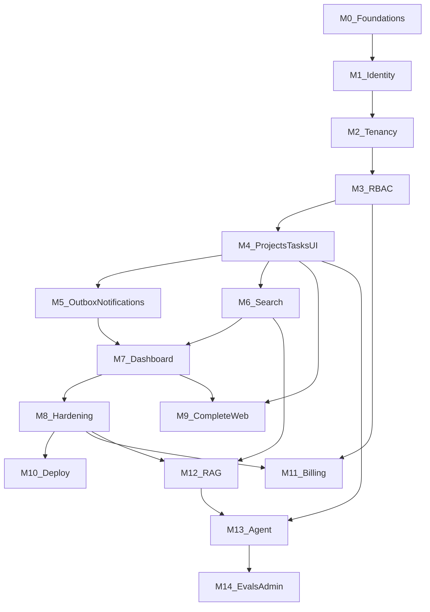

# Roadmap

Planning is complete. M0 is in progress. Check a box only when that milestone's acceptance criteria are met. Do not start the next milestone on the assumption that this one is done.

Pace: 8–12 hours per week. About 27–33 weeks. Overlaps noted below can shorten calendar time. They do not remove acceptance criteria.

Each milestone uses the same cycle: requirements, design, implementation, tests, debugging, performance, interview questions. One vertical slice is for the learner to attempt first. The interview pack is logged in [LEARNING_LOG.md](LEARNING_LOG.md) before the milestone is done. Questions are attempted before the answers are written down.

Standing rules:

- New routes are in the OpenAPI document, use the error envelope and the status-code policy, and have a contract test.
- The review checklist in the [README](../README.md) is applied to the branch diff.
- Weekly DSA practice continues and does not gate the milestone.

## Checklist

- [ ] M0 Foundations
- [ ] M1 Identity and session security
- [ ] M2 Organizations and tenancy
- [ ] M3 RBAC
- [ ] M4 Projects, tasks, and the first UI
- [ ] M5 Comments, activity, notifications, and the outbox
- [ ] M6 Documents and search
- [ ] M7 Dashboard
- [ ] M8 Hardening
- [ ] M9 Complete the web MVP
- [ ] M10 CI, deployment, and the production benchmark
- [ ] M11 Billing
- [ ] M12 RAG
- [ ] M13 Tool-calling assistant
- [ ] M14 Evals and operations

## Dependencies

M6 can overlap the end of M5. M9 completes screens that start in M4 and grow through M7, and it can overlap M8. M11 can overlap M10. M12 does not start before M1–M3 have passed, and it also waits for M6 and M8.

## Timeline

| Milestone | Focus | Time |
| --- | --- | --- |
| M0 | Foundations | 1.5 weeks |
| M1 | Identity and session security | 2–2.5 weeks |
| M2 | Tenancy | 1.5 weeks |
| M3 | RBAC | 1–1.5 weeks |
| M4 | Projects, tasks, first UI, benchmark | 2.5–3 weeks |
| M5 | Outbox, comments, notifications, idempotency | 3–3.5 weeks |
| M6 | Documents and search | 1.5–2 weeks |
| M7 | Dashboard and cache benchmark | 1.5–2 weeks |
| M8 | Hardening, RLS, pooled tenant context | 2–2.5 weeks |
| M9 | Complete web MVP | 1.5 weeks |
| M10 | CI, deploy, benchmark | 2–2.5 weeks |
| M11 | Billing module | 1.5 weeks |
| M12 | RAG | 2 weeks |
| M13 | Tool-calling assistant | 2–3 weeks |
| M14 | Evals and operations | 1.5–2 weeks |

## M0 — Foundations

Status: in progress. The skeleton and tests are in the repository. Compose health is checked after the API container is up. The interview discussion is not done until the questions in the learning log have been attempted.

Easy. Depends on nothing. About 1.5 weeks.

Repo skeleton, settings from the environment, structured logging, Alembic, Pytest against real PostgreSQL, Compose for API + PostgreSQL + Redis, and `/health`. Product routes mounted at `/api/v1` with OpenAPI. Ruff, mypy, and pre-commit. No domain tables.

Learning: layering, 12-factor config, why tests use real PostgreSQL, what a health check should prove, how versioning and lint gates protect later work.

System design: what a load balancer should learn from `/health`, and why this product starts as a modular monolith.

Learner slice: one required setting, with a test that the app refuses to boot when it is missing. That slice is `DATABASE_URL` in `app/core/config.py` and `tests/test_config.py`. Read those before changing them.

Done when:

- [x] Compose health returns 200, Pytest runs, Alembic upgrades an empty database, and the README explains how to boot.
- [x] pre-commit runs Ruff and mypy.
- [x] `/api/v1/openapi.json` loads, and `/health` stays unversioned.
- [x] Branching and commit rules are in the README.
- [x] Interview pack is in the learning log.

The milestone stays open until the M0 questions in the learning log have been attempted. Do not start M1 before that.

## M1 — Identity and session security

Medium. Depends on M0. About 2–2.5 weeks.

Register, login, refresh rotation, logout, current user. Argon2, dummy verify for unknown emails, no account enumeration. Refresh tokens hashed and grouped in families. Reuse, logout, password change, and password reset revoke as specified in [ADR 004](DECISIONS.md). Signed session-bound CSRF and cookie flags in [ADR 007](DECISIONS.md). CORS allowlist. Password reset is a single-use hashed token. The dev mailer logs the link. The request always returns 202. Status `active` and `disabled`.

Learning: JWT claims, hashed refresh tokens, rotation and reuse, signed CSRF, cookie injection, SameSite limits, XSS versus CSRF, why CORS is not a CSRF defense, cookie flags and paths, enumeration, revocation, account lifecycle.

System design: browser session design, including signed CSRF, token theft, and logout.

Learner slice: logout and reuse detection, after login and refresh exist.

Done when:

- [ ] Protected routes reject missing, expired, and revoked tokens.
- [ ] Refresh reuse revokes the chain.
- [ ] A cookie mutation without a valid signed CSRF header is rejected. A forged or cross-session token is rejected. A Bearer call does not require CSRF. A disallowed Origin is rejected.
- [ ] Cookie flags and paths match ADR 007.
- [ ] The learning notes contain the cookie-injection, SameSite, XSS, and CORS explanations.
- [ ] Reset returns 202 for known and unknown emails, works once, and revokes old refresh tokens.
- [ ] A disabled account cannot log in or refresh.
- [ ] Auth errors use the envelope and the status-code policy. Contract tests cover them.
- [ ] Interview pack is logged.

## M2 — Organizations and tenancy

Medium-hard. Depends on M1. About 1.5 weeks.

Create an organization, membership, switch organization, invite by email as a pending membership. The invite row is the product. Every tenant table includes `organization_id`. Membership is unique on `(organization_id, user_id)`.

Learning: shared schema versus schema-per-tenant versus database-per-tenant, IDOR, server-side tenant context, how the unique pair enables a composite foreign key.

System design: tenancy for about 100 organizations, and how isolation is tested.

Learner slice: accept a pending invite.

Done when:

- [ ] A member of org A receives 404 on org B's resources.
- [ ] A repository test fails if the org filter is removed.
- [ ] Creating an org makes the creator `owner`.
- [ ] A duplicate membership hits the database unique constraint.
- [ ] Interview pack is logged.

## M3 — RBAC

Medium. Depends on M2. About 1–1.5 weeks.

Roles `owner`, `admin`, `member`, `viewer`. Checks live in dependencies. Owners cannot be removed by admins. The last owner cannot leave. Refactor any inline role check into those dependencies, behavior unchanged, in its own commit.

Learning: RBAC versus ABAC, fail closed, why hiding a button is not authorization.

System design: where authorization lives, and what would force ABAC.

Learner slice: add one permission and its tests.

Done when:

- [ ] Role by action is tested: viewer cannot write, member cannot manage members, admin cannot delete the org.
- [ ] The refactor commit does not change route behavior.
- [ ] Interview pack is logged.

## M4 — Projects, tasks, and the first UI

Medium-hard. Depends on M3. About 2.5–3 weeks.

Order: schema and API, tests, thin UI, benchmark. Backend first.

Project and task CRUD, allowlisted filters and sort, assignee rules, status transitions, keyset pagination. Composite foreign keys from tasks to projects and memberships. A minimal React app: login, register, organization switcher, projects, task list and create. Generated client. Plain Tailwind.

Locust baseline for list and create. Intentional N+1, then the fix. Record p50, p95, p99, throughput, database time, CPU, and memory in [SYSTEM_DESIGN_NOTES.md](SYSTEM_DESIGN_NOTES.md). Cache hit ratio is not applicable. Write the list `EXPLAIN` into [DATABASE_DESIGN.md](DATABASE_DESIGN.md). Refactor the list query after the fix, tests unchanged.

Learning: keyset versus offset, N+1, `EXPLAIN ANALYZE`, denormalized `organization_id` protected by a composite foreign key, reading a latency distribution.

System design: the task-list API, including indexes, pagination, and 100x data.

Learner slice: one status transition and its 409 test.

Debugging: find the N+1 from query count or database time, then add a regression test. Log it in [DEBUGGING_LOG.md](DEBUGGING_LOG.md).

Done when:

- [ ] Keyset pages do not skip or duplicate rows under concurrent inserts.
- [ ] A non-member cannot be assigned. A cross-organization SQL insert fails the composite foreign key.
- [ ] The list query plan is in the database design doc.
- [ ] Filters and sorts reject fields outside the allowlist.
- [ ] The browser can log in and create a task in the caller's organization.
- [ ] Both Locust runs and the N+1 diagnosis are recorded.
- [ ] Interview pack is logged.

## M5 — Comments, activity, notifications, and the outbox

Medium-hard. Depends on M4. About 3–3.5 weeks.

Comments with composite foreign keys. Activity in the same transaction as the change. In-app notifications. Transactional outbox and API idempotency as in [ADR 008](DECISIONS.md) and [ADR 012](DECISIONS.md). `traceparent` column present and unused until M8.

The API returns before fan-out finishes. At-least-once is the guarantee. Thin screens for comments, activity, and notifications come after the backend.

Learning: at-least-once delivery, why duplicate publish is safe only with an idempotent consumer, why mark-then-enqueue loses events, lock expiry, `SKIP LOCKED`, the poller as Redis recovery, request hashing, in-progress versus replay, mismatched payloads, activity versus notifications, eventual consistency.

System design: notification fan-out after a task update, including the crash windows and what the user observes.

Learner slice: comment creation writes the activity row in the same transaction.

Done when:

- [ ] Assigning a task notifies that user once even when the handler runs twice.
- [ ] Tests cover commit-then-crash-before-enqueue, enqueue error, ack-then-crash-before-mark, two workers, lock expiry, and Redis down then up.
- [ ] The unsafe mark-then-enqueue loss is written up, and the publisher marks `published` only after enqueue success.
- [ ] A dead lock holder is recovered after `locked_until`.
- [ ] The running poller publishes pending rows after Redis recovers, without a process restart.
- [ ] The worker is in Compose. Failed rows keep `last_error` and an attempt count.
- [ ] Concurrent comment creates with one idempotency key produce one comment. The loser receives 409 while the key is `in_progress`, then a retry replays the stored response.
- [ ] The same hash replays status and body. A different hash returns 422. An expired completed key can execute again.
- [ ] The UI shows comments and notifications for the current organization.
- [ ] Interview pack is logged.

## M6 — Documents and search

Medium-hard. Depends on M4. Can overlap the end of M5. About 1.5–2 weeks.

Text and markdown documents, optional project, composite foreign key, PostgreSQL full-text search, storage interface, local driver, documents and search screen. Upload rules in [ADR 017](DECISIONS.md).

Learning: `tsvector`, GIN, ranking, why a hit still passes tenant and permission checks, path traversal, why the storage key is not the client filename.

System design: PostgreSQL full-text search versus a dedicated search engine, using the capacity sketch.

Learner slice: the project-scoped document filter.

Done when:

- [ ] Search never returns another organization's rows.
- [ ] `EXPLAIN` shows the GIN index for a realistic query.
- [ ] A document the caller cannot access is absent even if the text matches.
- [ ] A document cannot reference another organization's project.
- [ ] `../../etc/passwd`, an absolute path, and a disallowed content type do not write outside the storage root and do not create a document.
- [ ] The screen can create a document and run a search.
- [ ] Interview pack is logged.

## M7 — Dashboard

Medium. Depends on M5 and M6. About 1.5–2 weeks.

My tasks, overdue counts, recent activity, per-project open-task counts. Benchmark uncached first. Add Redis only where the run shows it is worth it. Document invalidation. Thin dashboard screen.

Locust before and after the cache, including hit ratio. Intentional stampede, then a short single-flight lock. Record the runs in the system design notes.

Learning: TTL versus explicit invalidation, read models versus caching the write model, hit ratio, stampede, p99 versus p50.

System design: caching this dashboard, including what stays uncached on purpose.

Learner slice: one aggregate query and its test.

Done when:

- [ ] Dashboard numbers match the tables.
- [ ] Hit and miss are logged, and the benchmark records hit ratio.
- [ ] A note says what breaks if TTL is the only invalidation.
- [ ] The stampede is reproduced and the second run shows the change in database time or p95.
- [ ] The screen renders the same figures the API returns.
- [ ] Interview pack is logged.

## M8 — Hardening

Medium. Depends on M7. About 2–2.5 weeks.

Error-envelope audit, request ids, OpenTelemetry from HTTP to SQL and into the worker, login token-bucket rate limit, RLS as in [ADR 009](DECISIONS.md). Refactor drifted error handling into the shared handlers without changing status codes.

Learning: `SET LOCAL` versus session `SET`, pool reuse, fail-closed policies, owner bypass versus `FORCE` and a separate app role, worker tenant context, trace propagation, token bucket versus fixed window.

System design: layered tenant isolation on a pooled connection, and which layer fails in which direction.

Debugging: a trace that stops before the SQL span, then a trace that dies at the outbox because `traceparent` was not copied.

Done when:

- [ ] A request trace includes the database span and, for an assignment, the worker span from the same trace.
- [ ] Brute-force login is limited and tested.
- [ ] Errors omit stack traces and include the request id.
- [ ] RLS and the composite foreign key are both demonstrated, with notes on which failure each one catches.
- [ ] Pool size 1: organization A then organization B does not leak rows. The setting is empty after A's transaction.
- [ ] The worker reuse test does the same for event A then event B.
- [ ] `devsphere_app` has `rolbypassrls = false`. A query with no `set_config` returns no tenant rows. The app role cannot disable row security.
- [ ] The error-handling refactor does not change status codes.
- [ ] Interview pack is logged.

## M9 — Complete the web MVP

Medium. Depends on the M4 shell and the M5–M7 screens. Best after M8. Can overlap M8. About 1.5 weeks.

This finishes the functional frontend. Regenerate the client for the MVP surface. Empty organizations, expired sessions, CSRF on every mutation, screens working together. Little visual design.

Learning: generated client versus OpenAPI, handling 401, 403, and 404, why the UI is not authorization.

System design: the SPA calling `/api/v1` directly, and what a backend-for-frontend would add that this product does not need yet.

Learner slice: empty state and expired-session handling.

Done when:

- [ ] Auth, org switcher, projects, tasks, comments, notifications, documents, search, and dashboard work against Compose in a browser.
- [ ] An expired session returns to login. An empty organization has a usable empty state.
- [ ] A viewer cannot complete a write the API rejects.
- [ ] Interview pack is logged.

## M10 — CI, deployment, and the production benchmark

Hard. Depends on M8. The web build joins once M9 exists. About 2–2.5 weeks.

GitHub Actions, Nginx, TLS explanation, one cloud target chosen at the start of the milestone, backups, restore, health, migration rules in [ADR 014](DECISIONS.md) and [DEPLOYMENT.md](DEPLOYMENT.md).

Locust through Nginx. Compare with M4. Intentional pool or index bottleneck that splits p50 from p99, then a second run.

Learning: DNS to proxy to app to database to worker, expand/contract, failed migration transactions, forward fix, staging versus production.

System design: deploy and rollback, including a failed migration and the worker.

Learner slice: the Compose Nginx route for `/api/v1`.

Done when:

- [ ] CI is green on a pull request, including lint, types, and tests.
- [ ] Nginx routes `/api` and the web app.
- [ ] A backup restores into a clean database.
- [ ] A revision that fails mid-upgrade leaves the schema and `alembic_version` on the previous revision.
- [ ] Deploy notes cover expand/contract, backup-before-migrate, and forward fix.
- [ ] The request path and the benchmark comparison are written up.
- [ ] Interview pack is logged.

## M11 — Billing

Medium-hard. Depends on M3 and M8. Can overlap M10. About 1.5 weeks. Stays a separate module.

Plans, subscription states, provider interface. Stripe test mode if keys exist. Otherwise a fake provider that posts HMAC-signed webhooks. Verify the signature on the raw body before trusting it. Reject a missing signature, a bad signature, and a stale timestamp. Idempotent inbox. One feature gate, such as member count.

Learning: webhook retries, signature on the raw body, timestamp tolerance, state machines, the stored event as the source of truth after the inbox accepts it.

System design: subscription state and webhook processing inside this monolith.

Learner slice: the member-count gate and its test.

Done when:

- [ ] A missing or invalid signature does not change subscription state.
- [ ] A stale timestamp is rejected.
- [ ] A duplicate verified webhook does not double-apply.
- [ ] A past-due subscription enforces the chosen limit.
- [ ] Role checks still protect billing routes.
- [ ] Interview pack is logged.

## M12 — RAG

Hard. Depends on M6 and M8, which already require M1–M3. About 2 weeks. Do not start early.

Chunk documents, embed through the provider interface, store vectors in pgvector, retrieve with organization and permission filters, answer with citations. About ten labeled questions, checked by script. Chunks reference documents with a tenant-safe key.

Learning: chunk size, metadata filters, hallucination versus retrieval miss, why a vector store is not a security boundary.

System design: tenant-safe retrieval, and when pgvector in PostgreSQL would be left behind.

Learner slice: the permission filter on retrieval, with a failing test first.

Done when:

- [ ] Answers cite only documents the caller can read.
- [ ] A cross-tenant document with the same text is never retrieved.
- [ ] The eval script reports hit rate.
- [ ] Interview pack is logged.

## M13 — Tool-calling assistant

Hard. Depends on M12 and M4. About 2–3 weeks.

Read tools: search docs, list overdue tasks, summarize a project. One write tool: create a task, only through a backend confirmation as in [ADR 013](DECISIONS.md). Conversation history per user and organization. Pydantic argument validation. Audit of tool name, arguments, result, issued confirmation, and execution.

Learning: tool loop, context limits, prompt injection, why a model-generated confirmation flag is untrusted, one-time argument-bound approvals, tenant-scoped tools.

System design: an agent that can change data inside tenant and role limits.

Learner slice: the expiry check on confirm.

Done when:

- [ ] The model cannot reach a tool the user's role forbids.
- [ ] A poisoned document cannot widen permissions.
- [ ] No task is written without a backend confirmation. A model-supplied confirmed flag does not write a row.
- [ ] A valid confirmation creates one task. The second submit returns 409.
- [ ] Modified arguments, an expired confirmation, and another user or organization write nothing.
- [ ] Tool calls, confirmations, and executions are audited.
- [ ] Interview pack is logged.

## M14 — Evals and operations

Hard. Depends on M13. About 1.5–2 weeks.

Eval set for tool choice and refusal. Token and latency notes. Provider or tool failure behavior. Admin routes for failed jobs, recent errors, and tenant counts, limited to a platform operator role that is not organization `owner`.

Learning: evaluating tool choice and refusal, platform operations versus organization administration, failing closed when the provider errors.

System design: operating this monolith with the jobs, traces, and admin views this milestone adds.

Learner slice: one refusal case in the eval set.

Done when:

- [ ] The eval script covers one successful tool call, one refusal, and one provider failure.
- [ ] Admin routes are denied to organization owners.
- [ ] Interview pack is logged.

## Refactor exercises

Behavior stays the same. Tests are already green. Each is its own commit.

- M3 — inline role checks move into dependencies.
- M4 — reshape the task list query after the N+1 fix.
- M8 — route-local error shaping moves into the shared handlers.

## Practice track

Not a milestone gate. 3–5 Python problems a week, logged so solved problems are not reassigned. Order and the log template are in [LEARNING_LOG.md](LEARNING_LOG.md).
